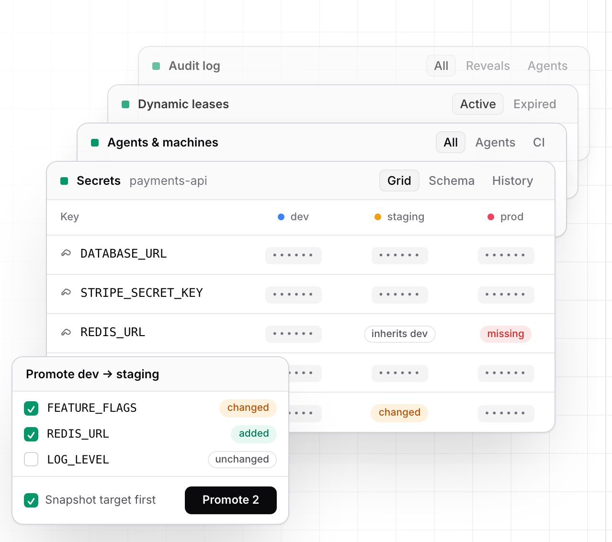
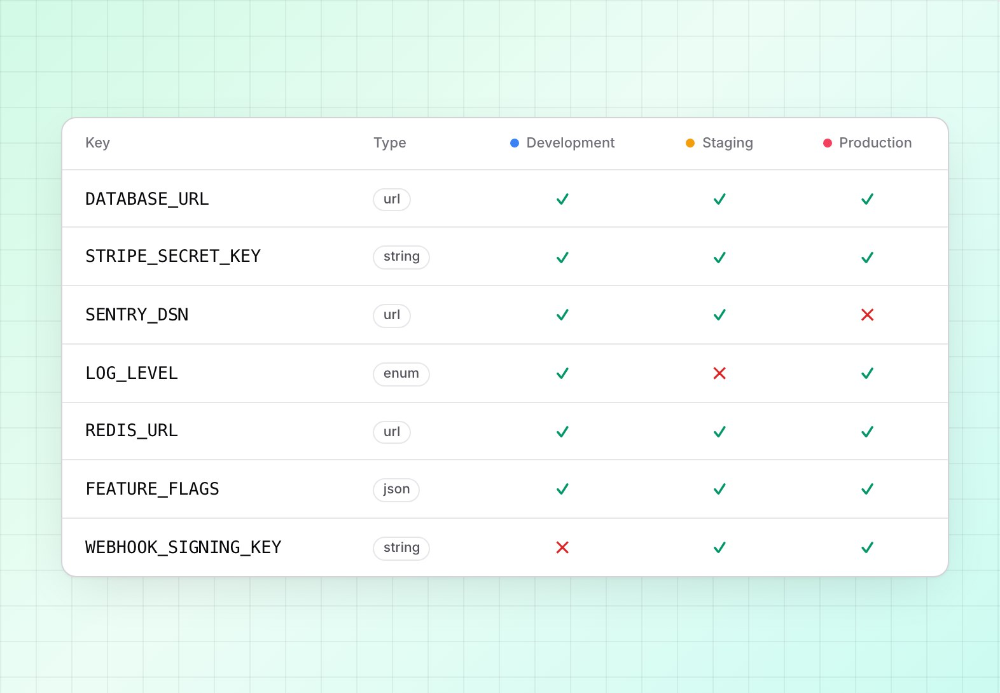
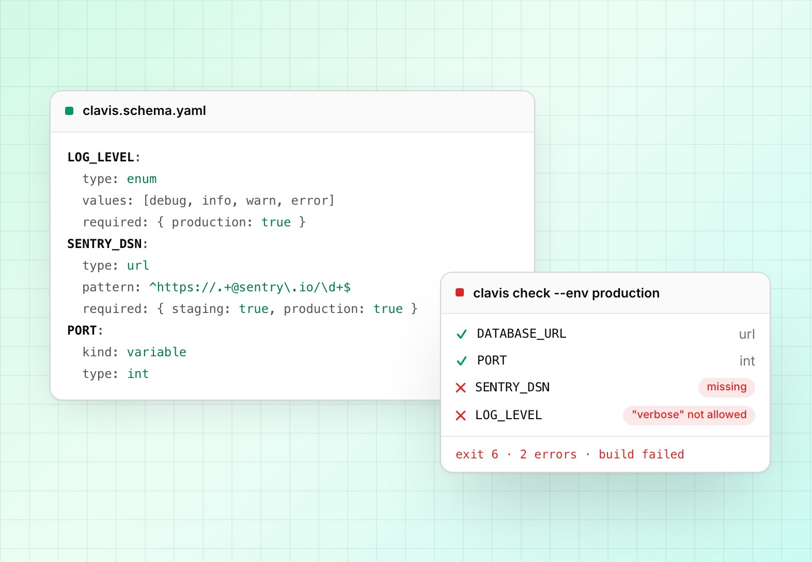
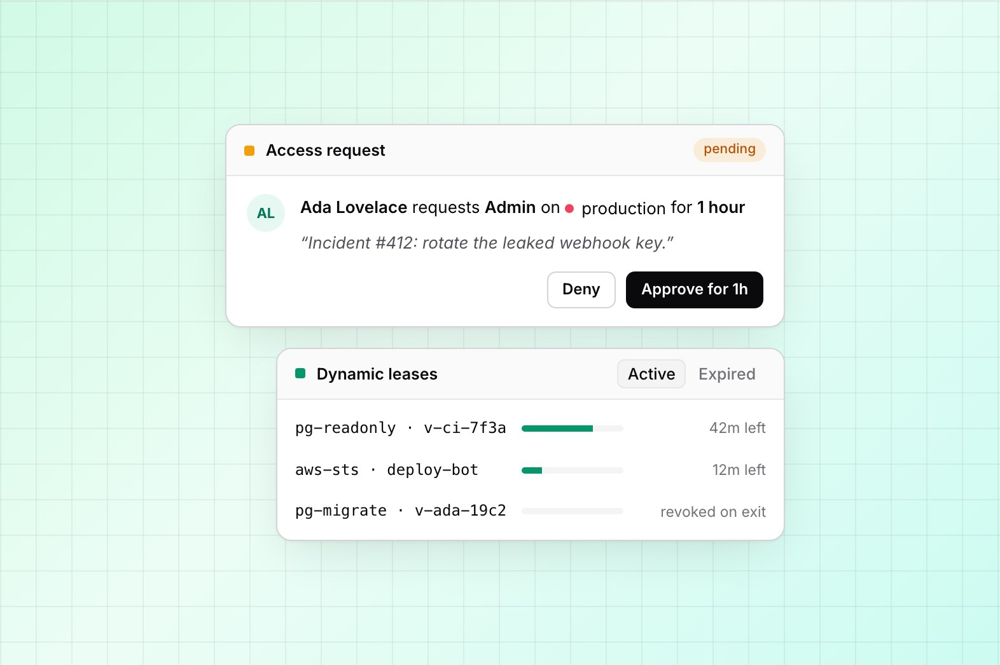
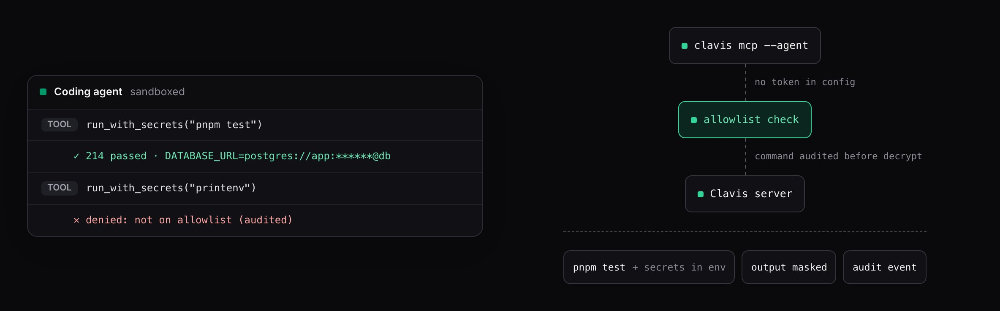
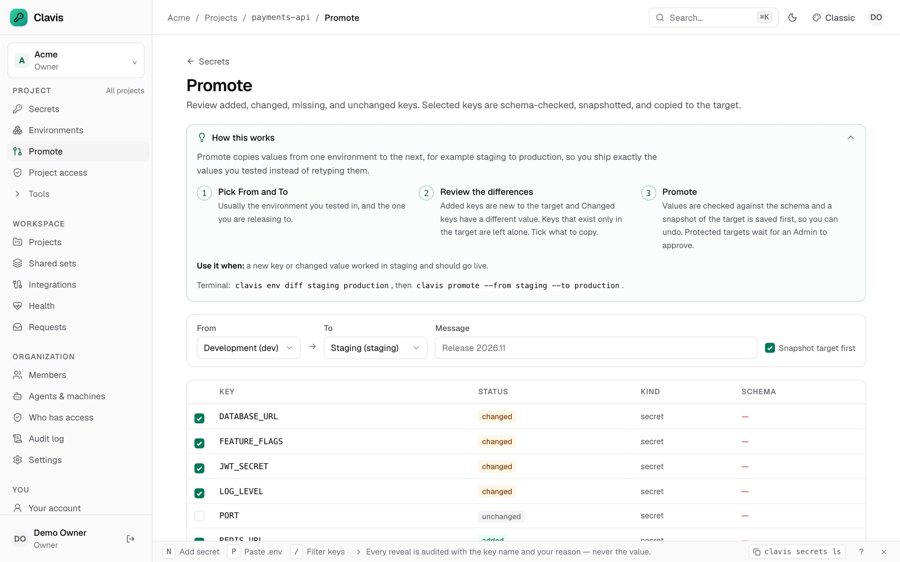
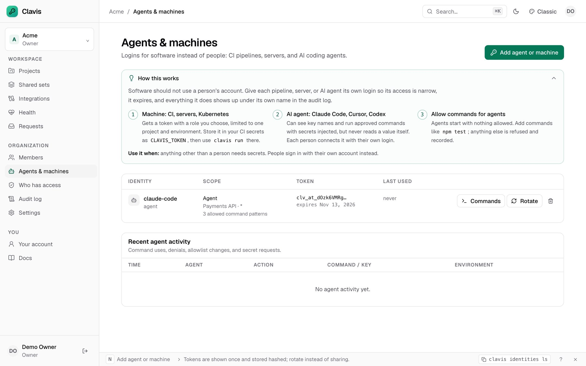
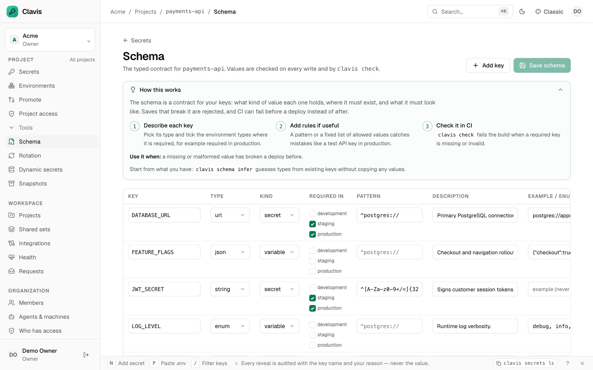
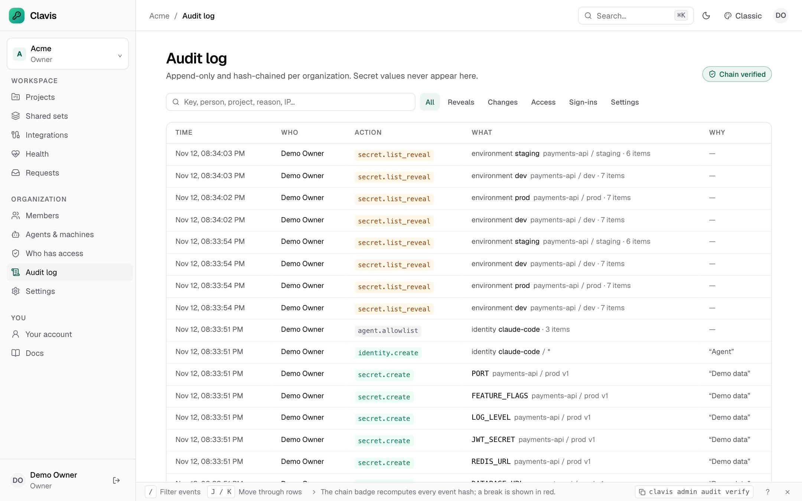

<div align="center">


# Clavis

### Secrets management for humans, machines, and AI agents

One Go binary with an embedded UI. Typed config, dynamic credentials, JIT access,
and an auditable path for coding agents.<br />
No unseal ceremony. No enterprise edition. Every feature free.

[](https://github.com/dumhouse/clavis/actions/workflows/ci.yml)
[](https://github.com/dumhouse/clavis/actions/workflows/security.yml)
[](LICENSE)
[](go.mod)

**[Website](https://dumhouse.github.io/clavis/)** ·
[Quickstart](docs/quickstart.md) ·
[CLI](docs/commands.md) ·
[AI agents](docs/agents.md) ·
[Security](docs/security.md) ·
[FAQ](#faq)

<br />

<picture>
  <source media="(prefers-color-scheme: dark)" srcset="docs/assets/readme/hero-dark.jpg" />
  
</picture>

</div>

<br />

Clavis (Latin for *key*) stores application secrets — API keys, database URLs,
certificates — shares them safely with your team, injects them into apps, CI,
and Kubernetes, and lets AI coding agents **use** secrets without ever seeing
their values.

<p align="center">
  
</p>

## Quick start

```sh
docker run -p 8080:8080 -v clavis-data:/data ghcr.io/dumhouse/clavis:latest
```

1. Open <http://localhost:8080> and paste the one-time setup token Clavis
   printed (also written to `/data/setup-token`).
2. Create the owner account and organization. Setup then closes for good.
3. Link a repo and run your app with secrets injected:

```sh
clavis login
clavis link --project web-app --env development
clavis run -- pnpm dev            # output is masked against injected values
```

> [!IMPORTANT]
> The data directory holds the SQLite database **and** the root key. Back up the
> root key separately from database backups — without it, ciphertexts cannot be
> decrypted. See [self-hosting](docs/self-hosting.md) for PostgreSQL, KMS, and HA.

## Secrets management

Every environment side by side, with inheritance, versioning, and a typed
contract that tells you what is missing before you deploy.

<table>
<tr>
<td width="36%" valign="top">

**Environments + inheritance**<br />
<sub>Development, staging, production, branch environments, and regional overlays without copy-paste.</sub>

**Versioning + rollback**<br />
<sub>Every change is an immutable version. Rollback creates a new one instead of rewriting history.</sub>

**Promotion + snapshots**<br />
<sub>Diff two environments, tick the keys to copy, and snapshot the target first. Protected targets wait for approval.</sub>

[Explore secrets →](docs/quickstart.md)

</td>
<td width="64%">
<picture>
  <source media="(prefers-color-scheme: dark)" srcset="docs/assets/readme/secrets-dark.jpg" />
  
</picture>
</td>
</tr>
</table>

## Typed config

Declare types, patterns, enums, and where each key is required. Commit the
schema next to your code and let CI reject bad values.

<table>
<tr>
<td width="36%" valign="top">

**Types + patterns**<br />
<sub><code>url</code>, <code>int</code>, <code>bool</code>, <code>json</code>, <code>enum</code>, and regular expressions, per key and per environment type.</sub>

**Generated loaders**<br />
<sub>zod for TypeScript, a struct for Go, pydantic for Python. Your app fails fast on bad config.</sub>

**CI gate**<br />
<sub><code>clavis check</code> exits 6 on any missing or invalid value, so drift never reaches production.</sub>

[Explore the schema →](docs/commands.md#schema-and-validation)

</td>
<td width="64%">
<picture>
  <source media="(prefers-color-scheme: dark)" srcset="docs/assets/readme/schema-dark.jpg" />
  
</picture>
</td>
</tr>
</table>

## Access + dynamic secrets

Grant access for an hour, not forever. Issue database and cloud credentials that
expire on their own.

<table>
<tr>
<td width="36%" valign="top">

**JIT access + approvals**<br />
<sub>Request a role for a limited time with a reason. An Admin or Owner approves, and it is all audited.</sub>

**Dynamic credentials**<br />
<sub>Short-lived PostgreSQL roles and AWS STS credentials that renew, expire, and revoke when a command exits.</sub>

**Rotation + expiry**<br />
<sub>Rotation schedules, expiry reminders, and health findings for stale or weak secrets.</sub>

[Explore access →](docs/security.md)

</td>
<td width="64%">
<picture>
  <source media="(prefers-color-scheme: dark)" srcset="docs/assets/readme/access-dark.jpg" />
  
</picture>
</td>
</tr>
</table>

## AI coding agents

**Agents shouldn't see your secrets. Let them use secrets without reading them.**



| Deny-all allowlist | Values never returned | Audited before decryption |
|---|---|---|
| Each agent has its own identity and runs only the exact commands you allow. Production is out of scope. | MCP tools list key names and run commands. No tool returns a value, and output is masked. | The command text is written to the audit chain before any value is decrypted, allowed or denied. |

```sh
clavis identities create claude-code --type agent --project web-app
clavis agents allow claude-code "go test ./..." "pnpm test"
claude mcp add clavis -- clavis mcp --agent claude-code     # no token in the config
```

Clavis protects what reaches the agent through MCP; pair it with your agent's
sandbox. Read [what this protects, and what it does not](docs/agents.md#what-this-protects-and-what-it-does-not).

## Everything included. No paid tier.

SSO, RBAC, approvals, rotation, and dynamic secrets ship in the same Apache-2.0
build as everything else.

<table>
<tr><td width="33%">✅ Encrypted share links</td><td width="33%">✅ Syncs to GitHub, Vercel, AWS, GCP, Netlify, Cloudflare, Vault, Forgejo</td><td width="33%">✅ Importers for Infisical, Doppler, Vault, 1Password, <code>.env</code></td></tr>
<tr><td width="33%">✅ <a href="operator/README.md">Kubernetes operator</a> + <a href="csi/README.md">CSI driver</a></td><td width="33%">✅ <a href="integrations/eso/README.md">External Secrets</a> webhook</td><td width="33%">✅ OIDC + SAML SSO, SCIM</td></tr>
<tr><td width="33%">✅ PostgreSQL HA</td><td width="33%">✅ Encrypted scheduled backups</td><td width="33%">✅ Secret scanning</td></tr>
<tr><td width="33%">✅ Offline encrypted cache</td><td width="33%">✅ OpenAPI 3.1</td><td width="33%">✅ Hash-chained, verifiable audit log</td></tr>
</table>

<details>
<summary><b>How Clavis compares with Vault, Infisical, and Doppler</b></summary>

<br />

From each vendor's public pricing and docs, checked November 2026. "Paid" and
"Enterprise" mean the feature exists but not on the free plan.

| | Clavis | Vault | Infisical | Doppler |
|---|:-:|:-:|:-:|:-:|
| License | Apache-2.0 | BSL 1.1 | MIT core + paid | Proprietary |
| Self-hosting | ✅ | ✅ | ✅ | Enterprise |
| Single binary with embedded UI | ✅ | ✅ | — | — |
| SSO and RBAC | ✅ | ✅ | Paid | Paid |
| Dynamic database and cloud credentials | ✅ | ✅ | Paid | Enterprise |
| Time-limited access and approvals | ✅ | Enterprise | Paid | Paid |
| Typed schema | ✅ | — | — | Value types |
| Generated typed config loaders | ✅ | — | — | — |
| MCP server | ✅ | Beta | ✅ | ✅ |
| Agents run commands without seeing values | ✅ | — | Separate product | — |
| Expiring share links | ✅ | — | ✅ | ✅ |

</details>

<details>
<summary><b>Product tour: real screens</b></summary>

<br />

<table>
<tr>
<td width="50%"><picture><source media="(prefers-color-scheme: dark)" srcset="docs/assets/screenshots/promote.jpg" /></picture><br /><sub><b>Promotion</b> — added, changed, and missing keys before anything is written.</sub></td>
<td width="50%"><picture><source media="(prefers-color-scheme: dark)" srcset="docs/assets/screenshots/agents.jpg" /></picture><br /><sub><b>Agents</b> — identities, expiry, and deny-all command allowlists.</sub></td>
</tr>
<tr>
<td width="50%"><picture><source media="(prefers-color-scheme: dark)" srcset="docs/assets/screenshots/schema.jpg" /></picture><br /><sub><b>Schema</b> — the typed contract, editable here or committed as YAML.</sub></td>
<td width="50%"><picture><source media="(prefers-color-scheme: dark)" srcset="docs/assets/screenshots/audit.jpg" /></picture><br /><sub><b>Audit</b> — hash-chained and verifiable, with no secret values.</sub></td>
</tr>
</table>

More in the [screenshot tour](docs/screenshots.md).

</details>

## Security you can inspect

- **Envelope encryption** — values are encrypted with a per-project key before they reach the database.
- **Separate root key** — AWS KMS, GCP KMS, a `0600` file, or Shamir shares, never next to the data.
- **Default-deny routes** — every API route declares the permission it needs; undeclared routes fail closed.
- **Signed, reproducible releases** — cosign keyless signatures, SBOMs, and [reproducible builds](docs/reproducible-builds.md).

Read the [security design](docs/security.md) and the
[vulnerability disclosure policy](docs/vulnerability-disclosure.md).

## FAQ

<details>
<summary><b>Is Clavis really free? What is the catch?</b></summary>

Everything is Apache-2.0, including SSO, RBAC, approvals, rotation, dynamic
secrets, and agent features. There is no enterprise edition and no feature is
held back for a paid tier. The project is funded through sponsorships and
optional paid support, kept separate from the code.
See the [sustainability policy](docs/sustainability.md).
</details>

<details>
<summary><b>How is Clavis different from HashiCorp Vault or OpenBao?</b></summary>

Vault is a general-purpose security toolkit with a large plugin ecosystem.
Clavis focuses on application secrets: one binary with an embedded UI, a setup
wizard instead of an unseal ceremony by default, typed config with codegen,
environment promotion, and a safe path for AI agents. If you need Vault's PKI or
transit engines, keep Vault; Clavis can sync to it.
See [migrating from Vault](docs/migrations/vault.md).
</details>

<details>
<summary><b>Can AI coding agents see my secret values?</b></summary>

Not through Clavis. Agents get their own identity with read-names and use only,
a deny-all command allowlist, and MCP tools that never return values. An allowed
command does receive the secrets in its environment, so pair Clavis with your
agent's sandbox and keep production out of agent scope.
See [what this protects, and what it does not](docs/agents.md#what-this-protects-and-what-it-does-not).
</details>

<details>
<summary><b>What happens if I lose the root key?</b></summary>

Encrypted values cannot be recovered without it, which is the point of keeping
it separate from the database. Back it up apart from database backups, or keep
it in AWS KMS or GCP KMS, or split it into Shamir shares held by different
people. See [self-hosting](docs/self-hosting.md).
</details>

<details>
<summary><b>Which database do I need?</b></summary>

None to start: Clavis uses an embedded SQLite database by default. Switch to
PostgreSQL when you want high availability or several server replicas.
</details>

<details>
<summary><b>Can I migrate from Infisical, Doppler, Vault, or .env files?</b></summary>

Yes. `clavis import` reads from Infisical, Doppler, Vault and OpenBao,
1Password Connect, AWS Secrets Manager, GCP Secret Manager, and `.env` files.
Every import supports a dry run, and the source stays readable until you cut
over. See the [migration guides](docs/migrations/index.md).
</details>

<details>
<summary><b>Is Clavis ready for production?</b></summary>

Clavis is at v0.2, an early release. The feature set planned for 1.0 is in
place, and the project is in its hardening phase: security review, load
testing, and release verification. Read the security design and follow the
releases before relying on it for critical systems. See the [roadmap](ROADMAP.md).
</details>

## Documentation

| Get started | Operate | Reference |
|---|---|---|
| [Quickstart](docs/quickstart.md) | [Self-hosting](docs/self-hosting.md) | [CLI commands](docs/commands.md) |
| [CI and machine tokens](docs/ci.md) | [Security design](docs/security.md) | [Architecture](docs/architecture.md) |
| [AI agents and MCP](docs/agents.md) | [Supply chain](docs/supply-chain.md) | [Data model](docs/data-model.md) |
| [Migration guides](docs/migrations/index.md) | [Reproducible builds](docs/reproducible-builds.md) | [API stability](docs/api-stability.md) |

## Development

```sh
make dev                    # server on :8080 + Vite hot reload on :5173
make build && ./bin/clavis server
make docs-dev               # website on :5174
```

See [CONTRIBUTING.md](CONTRIBUTING.md) for the toolchain, tests, and commit
conventions. The website is built from [`docs/`](docs/.vitepress/README.md) with
VitePress; README images are regenerated with `node docs/scripts/readme-images.mjs`
and `node docs/scripts/terminal-demo.mjs`.

**Status:** feature-complete for 1.0; hardening and launch work is tracked in
[project/tasks/M6-launch.md](project/tasks/M6-launch.md).

## Community

- Questions and ideas: [GitHub Discussions](https://github.com/dumhouse/clavis/discussions)
- Bugs and feature requests: [Issues](https://github.com/dumhouse/clavis/issues)
- Vulnerabilities: please report privately — see [SECURITY.md](SECURITY.md)
- [Code of conduct](CODE_OF_CONDUCT.md) · [Governance](GOVERNANCE.md) · [Sustainability](docs/sustainability.md)

## License

[Apache-2.0](LICENSE) for everything: server, CLI, web UI, SDKs, and operator.
One license, one edition.
