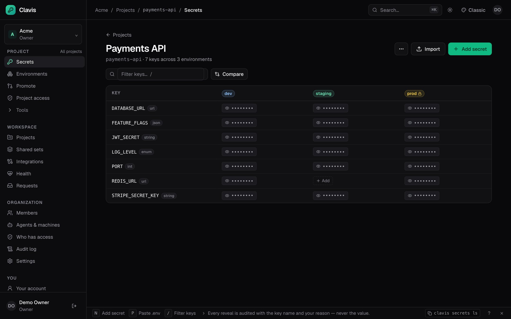
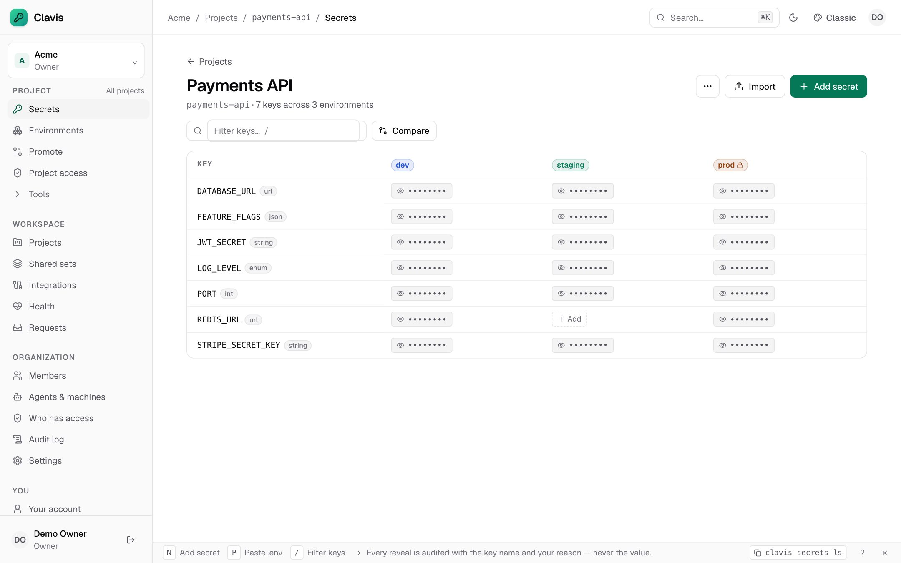

# Quickstart

Get a Clavis instance running and store your first secret in about five
minutes.

## 1. Run the server

Single binary:

```sh
make build
./bin/clavis server
```

or with Docker:

```sh
docker run --rm -p 8080:8080 -v clavis-data:/data ghcr.io/dumhouse/clavis:latest
```

Data lives in `./data` (SQLite database and the root key). The root key is
created with `0600` permissions. **Back it up separately from database
backups** — without it the ciphertexts cannot be decrypted.

## 2. Claim the instance

On first start Clavis prints a one-time setup token and writes it to
`<data-dir>/setup-token` (for example `./data/setup-token`).

Open <http://localhost:8080>, paste the token, and create:

- your owner account (12+ character password),
- your organization,
- optionally, a first project.

Setup closes permanently once the owner exists. The token file is deleted.

## 3. Store a secret

In the web app, open your project, click **Add secret**, and enter a key such
as `STRIPE_SECRET_KEY` and its value. The value is encrypted with a project key
before it reaches SQLite. Revealing it writes an audit event.

Secrets are versioned automatically. Updating creates a new immutable version;
rollback creates another version rather than rewriting history.




More screens in the [screenshot tour](screenshots.md).

## 4. Use the API

The API is versioned under `/api/v1` and documented by the OpenAPI 3.1
document at `/api/v1/openapi.json`.

Browsers use an HttpOnly session cookie plus a double-submit CSRF token. A
cookie-based script looks like this:

```sh
BASE=http://localhost:8080

# Sign in; -c stores the session and CSRF cookies.
curl -sS -c cookies.txt -H 'Content-Type: application/json' \
  -d '{"email":"owner@example.com","password":"correct horse battery staple"}' \
  "$BASE/api/v1/auth/login"

CSRF=$(awk '$6=="clavis_csrf"{print $7}' cookies.txt)

# Create a secret (CSRF header required for unsafe methods).
curl -sS -b cookies.txt -H "X-CSRF-Token: $CSRF" -H 'Content-Type: application/json' \
  -d '{"key":"DATABASE_URL","value":"postgres://…"}' \
  "$BASE/api/v1/orgs/acme/projects/web-app/environments/dev/secrets"

# List key names without values.
curl -sS -b cookies.txt \
  "$BASE/api/v1/orgs/acme/projects/web-app/environments/dev/secrets"
```

Machine tokens and workload identity are available; see [ci.md](ci.md) for CI
setup and [agents.md](agents.md) for agent identities.

## 5. Run with secrets

```sh
# Sign in with the browser device flow; the token is stored in the OS keychain.
clavis login --server http://localhost:8080

# Link this repository to a project and choose a default environment.
clavis init

# Read and write secrets.
clavis secrets ls
clavis secrets set DATABASE_URL
clavis secrets get DATABASE_URL
clavis run -- npm run dev
```

`clavis run` injects secrets as environment variables and masks values (and
their base64/URL-encoded forms) in stdout/stderr. Masking is a convenience, not
a boundary: prefer short-lived dynamic credentials for agents.

That is all local setup needs: `clavis login` stores the session token in the OS
keychain, and `clavis init` commits the project context to `.clavis.yaml`.

**In CI**, there is no browser to complete the login. Create a machine identity
under **Agents & machines**, scope it to a project and environment, and set its
`clv_mt_…` token as `CLAVIS_TOKEN` in the CI secret store. If the repository
commits `.clavis.yaml`, that token is the only variable a job needs (plus
`CLAVIS_SERVER` when the instance is not on localhost). See [ci.md](ci.md) for
GitHub Actions, GitLab, explicit scope variables, and workload OIDC.

### Docker and Compose

```sh
# Docker's env-file format (comments, no export prefix)
clavis export --format docker > .env
docker compose up --env-file .env
```

```yaml
# compose.yaml
services:
  app:
    image: my-app
    env_file: .env
```

File secrets can be mounted instead of injected as environment variables:

```sh
clavis run --mount -- ./start.sh   # FILE_KEY points at a 0600 temp file
```

## Invite a teammate

As an Owner or Admin, open **Members → Invite member**, choose a role and
expiry, and copy the single-use link. Invites can be restricted to an email
address. The same operation is available through the API.

## Postgres

```yaml
database:
  driver: postgres
  dsn: postgres://clavis:secret@db:5432/clavis?sslmode=require
```

Postgres runs the same migrations, queries, sessions, audit chain, and workers as
SQLite. Multiple replicas are supported: SSE events fan out over Postgres
`LISTEN/NOTIFY`, and job workers claim with `SKIP LOCKED`. Split process roles
with `clavis server --role=api` and `clavis server --role=worker`.

## Server configuration

These configure the server binary; environment variables override `clavis.yaml`.
Do not confuse `CLAVIS_SERVER_ADDR` (listen address) with `CLAVIS_SERVER` (the
CLI's target). CLI context variables are covered in [ci.md](ci.md) and
[cli.md](cli.md).

| Variable | Default | Purpose |
|---|---|---|
| `CLAVIS_SERVER_ADDR` | `:8080` | Listen address |
| `CLAVIS_SERVER_BASE_URL` | derived | Public URL used in docs and cookies |
| `CLAVIS_DATA_DIR` | `./data` | Data directory for defaults |
| `CLAVIS_DB_PATH` | `<data>/clavis.db` | SQLite file |
| `CLAVIS_DB_DSN` | — | Postgres DSN when `database.driver=postgres` |
| `CLAVIS_KEY_PROVIDER` | `file` | `file` or `env` root key |
| `CLAVIS_ROOT_KEY_FILE` | `<data>/root.key` | File provider path |
| `CLAVIS_ROOT_KEY` | — | Base64 32-byte key for the `env` provider |
| `CLAVIS_AWS_REGION` | — | Region for `aws-kms` |
| `CLAVIS_AWS_KMS_KEY_ID` | — | AWS KMS key ARN/ID |
| `CLAVIS_AWS_ACCESS_KEY` | — | AWS access key for KMS |
| `CLAVIS_AWS_SECRET_KEY` | — | AWS secret key for KMS |
| `CLAVIS_GCP_KMS_KEY` | — | GCP KMS crypto key resource name |
| `CLAVIS_GCP_SERVICE_ACCOUNT_FILE` | — | Service account JSON for GCP KMS |
| `CLAVIS_DEV` | `false` | Dev cookies at `http://localhost` and Vite proxy |
| `CLAVIS_LOG_LEVEL` | `info` | `debug`, `info`, `warn`, `error` |
| `CLAVIS_EMAIL_ENABLED` | `false` | Send password resets and invite emails |
| `CLAVIS_EMAIL_HOST` | — | SMTP host |
| `CLAVIS_EMAIL_PORT` | `587` | SMTP port |
| `CLAVIS_EMAIL_FROM` | — | From address (display name allowed) |
| `CLAVIS_BREACH_CHECK` | `false` | Check new passwords against the HIBP range API (k-anonymity) |
| `CLAVIS_BREACH_CHECK_URL` | HIBP range API | Override the breach-check endpoint |
| `CLAVIS_RATE_LIMIT_PER_MINUTE` | `600` | Per-identity API rate limit; `0` disables |
| `CLAVIS_BACKUP_ENABLED` | `false` | Write encrypted database backups from the server |
| `CLAVIS_BACKUP_DIR` | `<data>/backups` | Backup output directory |
| `CLAVIS_BACKUP_INTERVAL` | `24h` | Time between scheduled backups |
| `CLAVIS_BACKUP_KEEP` | `7` | Number of backup files to retain |

See [deploy/clavis.example.yaml](https://github.com/dumhouse/clavis/blob/main/deploy/clavis.example.yaml).

## Troubleshooting

- **`readyz` returns 503** — the database is unavailable or the root key could
  not be loaded. Check the server log; errors include a fix hint.
- **Cookies are not stored** — non-dev mode uses `Secure` `__Host-` cookies and
  requires HTTPS. Use `CLAVIS_DEV=true` only for local development.
- **Lost root key** — encrypted values are unrecoverable. Restore the key file
  from backup.
