# Product tour

Every screen below is the real web UI, running against a disposable demo
instance. They follow the site theme — use the toggle in the top bar to see
the other one. Click any image to view it full size.

::: tip Try it yourself
The UI ships inside the `clavis` binary. Start it with
`docker run -p 8080:8080 ghcr.io/dumhouse/clavis:latest` and follow the
[quickstart](./quickstart.md).
:::

## Secrets grid

One grid for every environment. Values stay masked until revealed, and every reveal is audited with the key and reason.

<figure>
  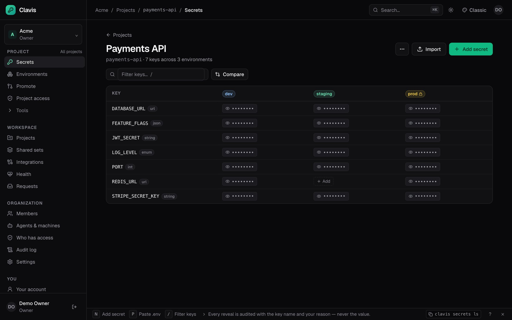
  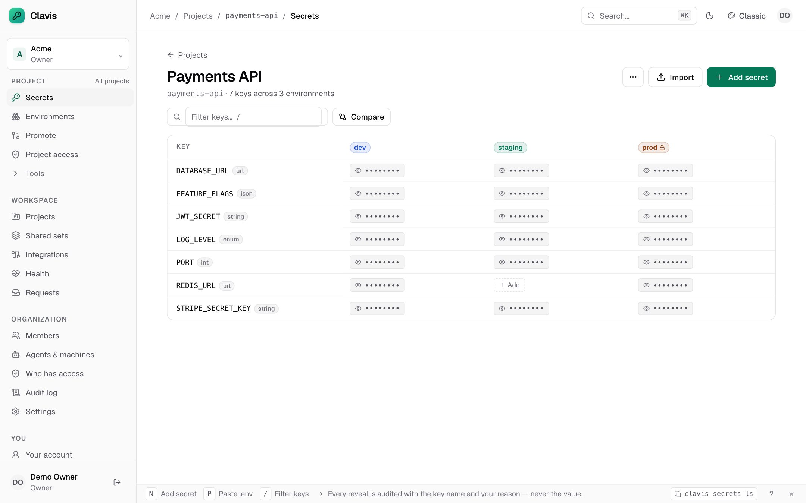
  <figcaption>Secrets grid in dark mode</figcaption>
</figure>

## Schema

Types, patterns, enums, and required environments are edited in one place. The same contract can be committed as `clavis.schema.yaml` and checked in CI.

<figure>
  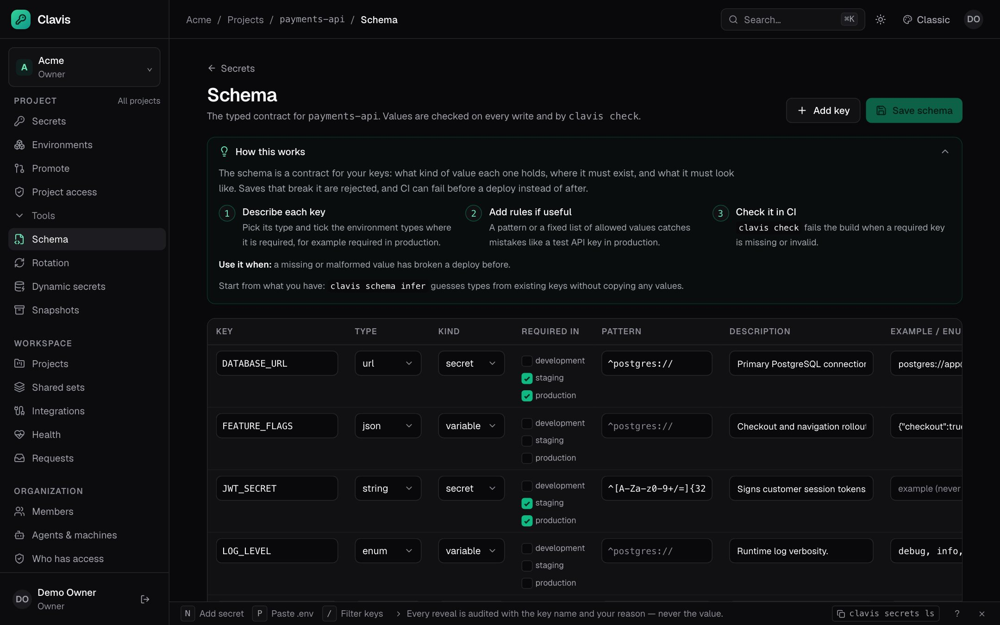
  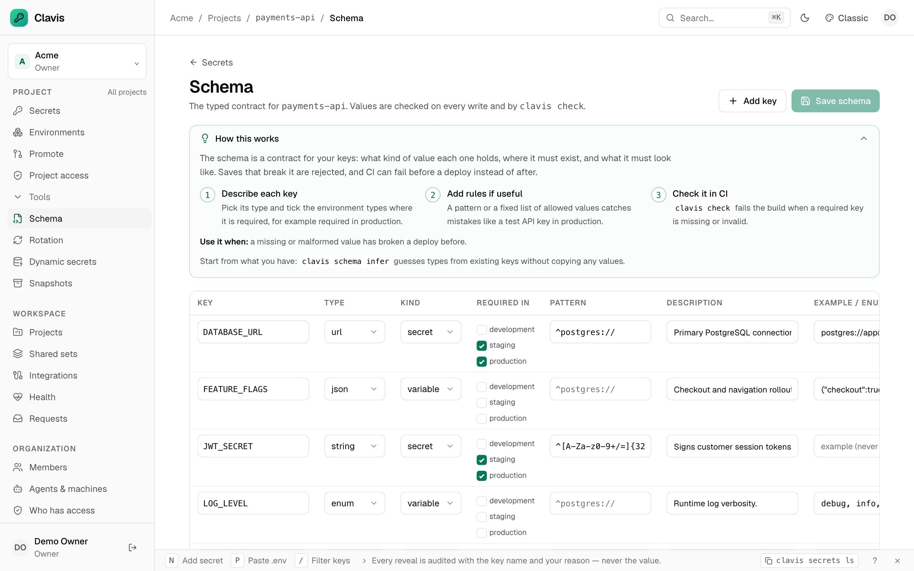
  <figcaption>Schema editor</figcaption>
</figure>

## Promotion

Promotion shows added, changed, missing, and unchanged keys. Selected keys are schema-checked and the target is snapshotted first; protected targets wait for approval.

<figure>
  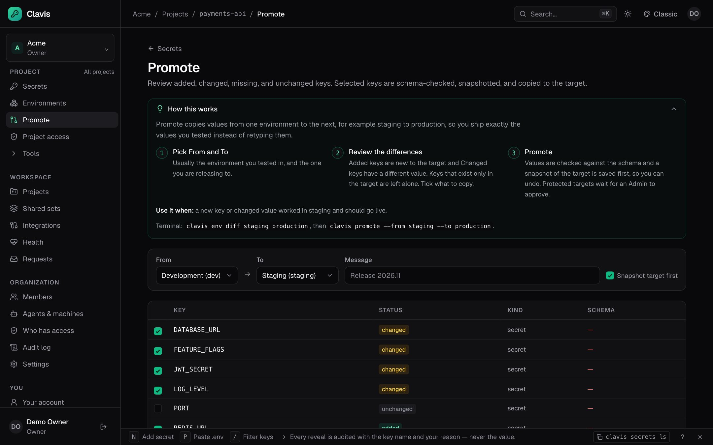
  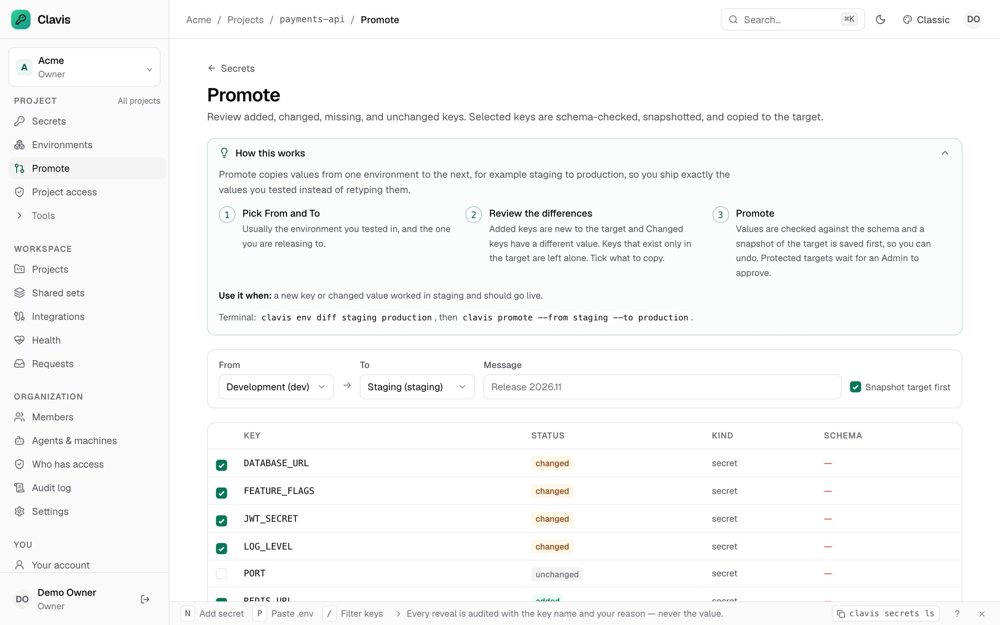
  <figcaption>Promotion plan</figcaption>
</figure>

## Agents and machines

Each agent gets its own identity, expiry, and deny-all command allowlist. The page also shows recent command use and denials.

<figure>
  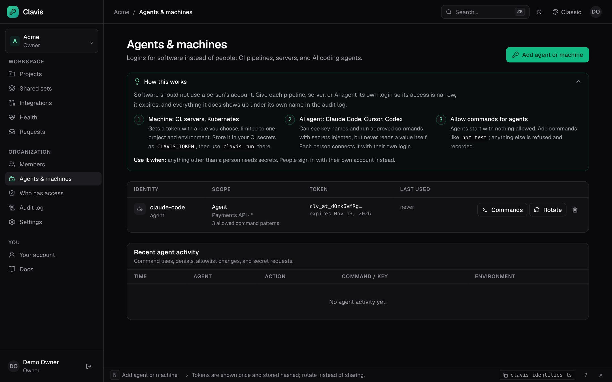
  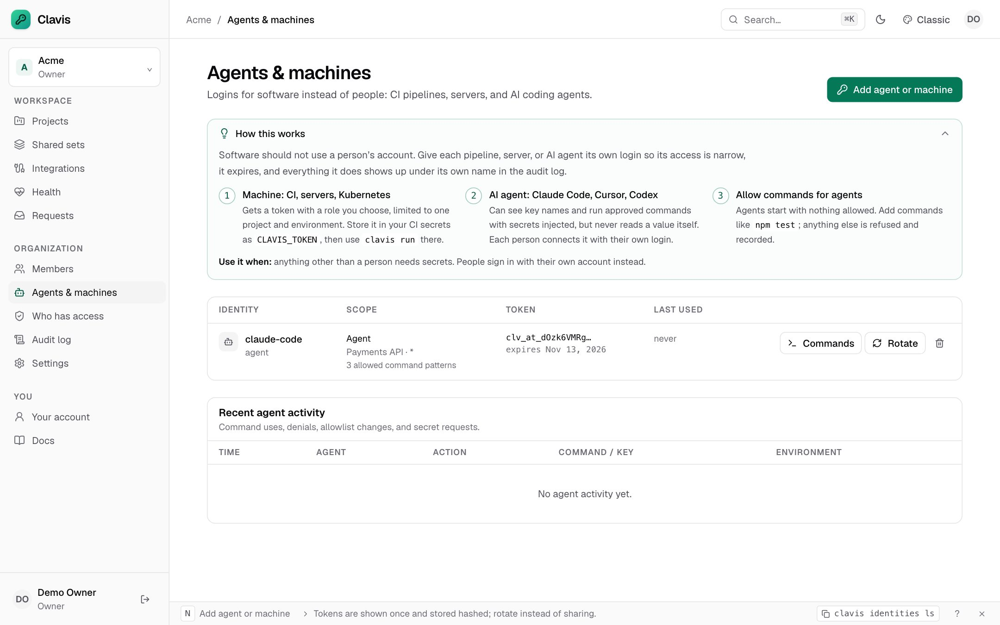
  <figcaption>Agent identities</figcaption>
</figure>

## Audit log

The audit chain is per organization, hash-chained, and verifiable. Secret values never appear.

<figure>
  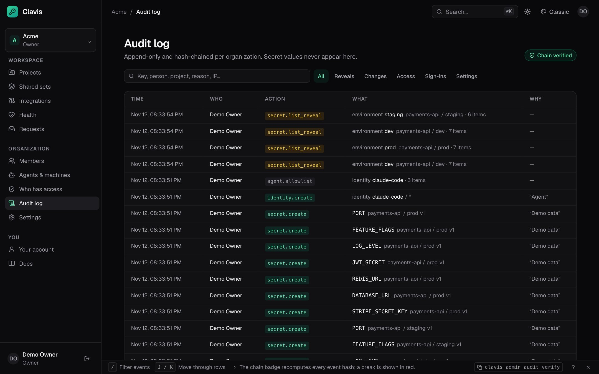
  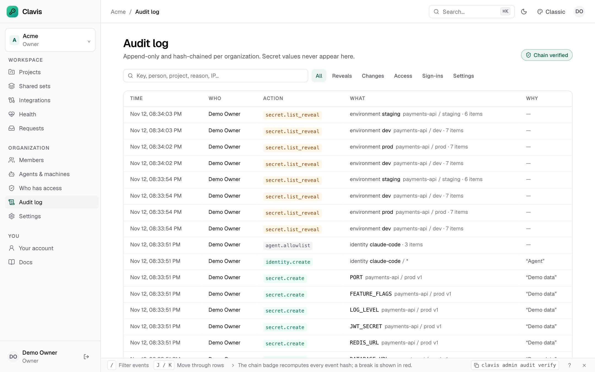
  <figcaption>Audit log</figcaption>
</figure>

## In-app documentation

The Docs page mirrors this site: guides, every CLI command, global flags, exit codes, and environment variables, all searchable.

<figure>
  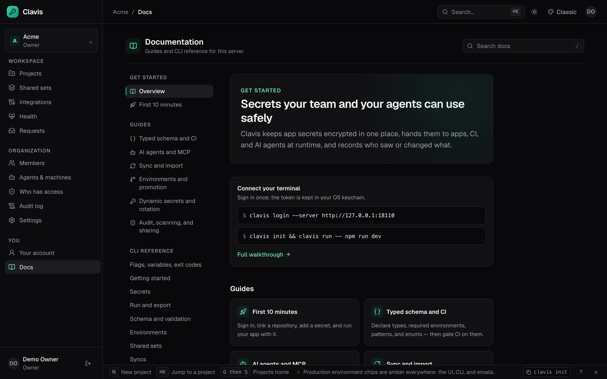
  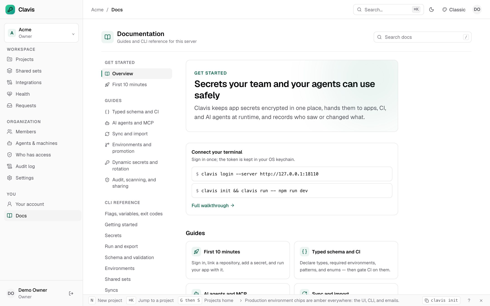
  <figcaption>In-app documentation</figcaption>
</figure>
